# ❄️ ThermoDC: Physics-Informed Machine Learning for Data Center Cooling Energy Prediction and PUE Optimization

[](https://www.python.org/downloads/)
[](https://creativecommons.org/licenses/by/4.0/)
[](http://localhost:8501)
[]()
[](https://pytorch.org/)

> **ThermoDC** is an end-to-end, physics-informed machine learning intelligence platform for enterprise and high-performance computing (HPC) data centers. It bridges thermodynamic physical principles with deep learning to accurately predict cooling power, detect equipment degradation, and optimize Power Usage Effectiveness (PUE) under dynamic climate and server workloads.

---

## 📑 Table of Contents

- [Overview & Industrial Context](#-overview--industrial-context)
- [System Architecture](#-system-architecture)
- [Key Innovations](#-key-innovations)
- [Thermodynamic Formulation](#-thermodynamic-formulation)
- [Repository Structure](#-repository-structure)
- [Experimental Benchmarks](#-experimental-benchmarks)
  - [NREL ESIF Chronological Split (Hold-out Future Months)](#1-nrel-esif-hpc-telemetry-modern-kestrel-era--chronological-8020-split)
  - [NREL ESIF Multi-Season Representative Split](#2-nrel-esif-hpc-telemetry-modern-kestrel-era--representative-8020-split)
  - [Commercial Building Management System (BMS) Telemetry](#3-real-dc-full-bms-telemetry-100330-scada-rows)
  - [Actual vs. Predicted Cooling Power Distribution](#4-actual-vs-predicted-cooling-power-distribution-mean--std)
- [Quickstart & Usage](#-quickstart--usage)
  - [Installation](#1-installation)
  - [CLI Evaluation Harness](#2-cli-evaluation-harness)
  - [Interactive Streamlit Intelligence Platform](#3-launch-interactive-intelligence-dashboard)
  - [Automated Verification Suite](#4-automated-test-suite)
- [Sample Datasets Guide](#-sample-datasets-guide)
- [College Submission & Academic Citation](#-academic-citation--college-submission)
- [License](#-license)

---

## 🌐 Overview & Industrial Context

Cooling systems account for **30% to 40%** of total data center electricity consumption worldwide. Traditional facility management relies on conservative static setpoints and empirical constant-PUE approximations ($Q_{\text{cool}} = k \cdot IT$), resulting in significant energy over-provisioning and thermal inefficiency.

Pure black-box machine learning models frequently suffer from:
1. **Physical Inconsistency**: Producing negative cooling predictions or violating the Carnot thermodynamic floor during extreme weather.
2. **Thermal Inertia Blindness**: Failing to capture chilled-water transport delays (1h–3h) and building thermal mass (6h rolling accumulation).
3. **Regime Shifts**: Catastrophic failure when facility chillers or cooling towers undergo mechanical retrofits.

**ThermoDC** solves these challenges by combining psychrometric physics, autoregressive operational feedback, and hard physical constraints inside PyTorch Physics-Informed Neural Networks (PINNs).

---

## 🏛️ System Architecture

```mermaid
flowchart TD
    subgraph Data Layer
        A1[NREL ESIF HPC Telemetry\nKestrel Era: Sep 2022 - Mar 2024]
        A2[Commercial DC BMS SCADA\n100,330 Continuous Rows]
        A3[Custom CSV / Parquet Upload\nUser Telemetry via Streamlit]
        A4[Synthetic Physics Simulator\nSimulate.py Ground Truth]
    end

    subgraph Feature Engineering & Psychrometrics
        B1[Stull Psychrometric Wet-Bulb T_wb]
        B2[Approach Temperature T_ambient - T_wb]
        B3[Thermal Transport Lags 1h, 2h, 3h]
        B4[Building Thermal Mass 6h Rolling Averages]
        B5[Solar Diurnal & Seasonal Harmonics]
        B6[Thermodynamic Cross-Interactions IT x T_wb]
    end

    subgraph Model Intelligence Engine
        C1[Baseline: Constant PUE Rule]
        C2[Polynomial Regression Deg 2]
        C3[Ridge + Physics Features]
        C4[Random Forest Regressor]
        C5[Gradient Boosted Trees HistGBDT]
        C6[Stacked Meta-Ensemble]
        C7[PyTorch LSTM Recurrent Network]
        C8[PyTorch Physics-Informed NN PINN]
        C9[Unsupervised LSTM Autoencoder]
    end

    subgraph Applications & Decision Support
        D1[Interactive Prediction & PUE Gauge]
        D2[Pre-flight Sensor Quality & Outlier Audit]
        D3[Leaderboard & 90th Pct Error Tracking]
        D4[Local Gradients & Global Sobol Sensitivity]
        D5[Climate Heatwave & IT Scaling Scenarios]
        D6[Zero-Shot Anomaly & Fault Isolation]
    end

    A1 & A2 & A3 & A4 --> B1 & B2 & B3 & B4 & B5 & B6
    B1 & B2 & B3 & B4 & B5 & B6 --> C1 & C2 & C3 & C4 & C5 & C6 & C7 & C8 & C9
    C1 & C2 & C3 & C4 & C5 & C6 & C7 & C8 & C9 --> D1 & D2 & D3 & D4 & D5 & D6
```



---

## 🔬 Key Innovations

- **Psychrometric Feature Extraction**: Incorporates the empirical Stull (2011) equation to calculate wet-bulb temperature ($T_{\text{wb}}$) from dry-bulb temperature and relative humidity, representing the true thermodynamic limit of evaporative cooling towers.
- **Autoregressive Plant Dynamics**: Tracks operational momentum using hydronic transport lags (`cooling_lag1`, `cooling_lag2`) and thermal accumulation (`cooling_roll6`).
- **Physics-Informed Loss Constraints (PINN)**: Penalizes non-physical predictions violating the Carnot limit ($\hat{y} \ge 0.02 \times IT$) and enforces non-negative gradient monotonicity ($\partial \hat{y} / \partial IT \ge 0$).
- **Multi-Sensor Unsupervised Fault Detection**: Employs an LSTM Autoencoder to reconstruct normal multi-channel sensor profiles, alerting operators to chilled-water flow blockages, cooling tower fan degradation, or thermal runaway.
- **Global Variance Decomposition**: Computes first-order ($S_1$) and total-effect ($S_T$) Sobol sensitivity indices via Monte Carlo quasi-random sampling.

---

## 📐 Thermodynamic Formulation

### 1. Stull Psychrometric Wet-Bulb Equation
$$T_{\text{wb}} = T \cdot \arctan\left(0.151977 \sqrt{\text{RH} + 8.313659}\right) + \arctan(T + \text{RH}) - \arctan(\text{RH} - 1.676331) + 0.00391838 \cdot \text{RH}^{1.5} \arctan(0.023101 \cdot \text{RH}) - 4.686035$$

### 2. Carnot Lower Bound & Monotonicity
The minimum thermodynamic work required to reject heat from the data center whitespaces to the ambient atmosphere is bounded by:
$$Q_{\text{cool}} \ge \eta_{\text{Carnot}} \cdot IT = \left(\frac{T_{\text{ambient}} - T_{\text{setpoint}}}{T_{\text{ambient}}}\right) \cdot IT$$

Furthermore, conservation of energy dictates that increasing compute load must monotonically increase cooling load:
$$\frac{\partial Q_{\text{cool}}}{\partial IT} \ge 0$$

### 3. PINN Composite Loss Function
$$\mathcal{L}_{\text{PINN}} = \mathcal{L}_{\text{MSE}}(y, \hat{y}) + \lambda_1 \cdot \frac{1}{N}\sum_{i=1}^{N} \max\left(0, 0.02 \cdot IT_i - \hat{y}_i\right)^2 + \lambda_2 \cdot \frac{1}{N}\sum_{i=1}^{N} \max\left(0, -\frac{\partial \hat{y}_i}{\partial IT_i}\right)^2$$

### 4. Power Usage Effectiveness (PUE)
$$\text{PUE} = \frac{P_{\text{total}}}{P_{\text{IT}}} = 1 + \frac{Q_{\text{cooling}} + P_{\text{aux}}}{P_{\text{IT}}}$$

---

## 📁 Repository Structure

```
dc-cooling/
├── .streamlit/
│   └── config.toml                  # Streamlit visual theme and layout config
├── data/
│   └── .gitkeep                     # Local data cache directory (gitignored)
├── tests/
│   ├── fixture.py                   # Mock telemetry generator for automated tests
│   ├── test_pipeline.py             # 10 comprehensive unit tests covering all features
│   └── wetbulb_stub.py              # Psychrometric test stubs
├── .gitignore                       # Git ignore rules (caches, local raw datasets)
├── README.md                        # Complete project documentation & benchmark report
├── app.py                           # Interactive Streamlit intelligence dashboard
├── data.py                          # Data loaders, psychrometrics, and feature engineering
├── eval_real.py                     # CLI benchmark evaluation harness for BMS & ESIF
├── fetch_data.py                    # NREL/NLR ESIF dataset downloader
├── model.py                         # 8 ML models, PyTorch PINN, and LSTM Autoencoder
├── requirements.txt                 # Project dependencies
├── simulate.py                      # Thermodynamic synthetic data center generator
├── test_datacenter_new.csv          # Sample dataset (8,760 hrs) for Streamlit upload demo
├── test_datacenter_sample.csv       # Sample dataset (8,760 hrs) for offline testing
└── test_real_dc_bms_cleaned.csv     # Cleaned commercial BMS SCADA sample dataset
```

---

## 📊 Experimental Benchmarks

### 1. NREL ESIF HPC Telemetry (Modern Kestrel Era — Chronological 80/20 Split)
*Evaluates forward-in-time into unseen winter operational months ($N = 2,544$ hold-out hours):*

| Model Architecture | Hold-out $R^2$ | Hold-out RMSE | Hold-out MAE | MAPE % | WMAPE % | CV $R^2$ | Skill vs Baseline | Fit Time |
| :--- | :---: | :---: | :---: | :---: | :---: | :---: | :---: | :---: |
| **Physics-Informed NN (PINN)** | **$+0.873$** | **$3.31\text{ kW}$** | $1.28\text{ kW}$ | **$2.11\%$** | $2.00\%$ | **$0.959$** | **$+93.5\%$** | $2.01\text{ s}$ |
| **LSTM Neural Network** | **$+0.869$** | **$3.37\text{ kW}$** | $1.20\text{ kW}$ | **$1.89\%$** | $1.88\%$ | **$0.959$** | **$+93.4\%$** | $1.64\text{ s}$ |
| **Random Forest** | **$+0.814$** | **$4.01\text{ kW}$** | $1.32\text{ kW}$ | **$2.01\%$** | $2.06\%$ | **$0.959$** | **$+92.1\%$** | $0.65\text{ s}$ |
| **Gradient Boosting** | **$+0.814$** | **$4.01\text{ kW}$** | $1.26\text{ kW}$ | **$1.86\%$** | $1.97\%$ | **$0.961$** | **$+92.1\%$** | $0.32\text{ s}$ |
| **Stacked Ensemble** | **$+0.815$** | **$4.00\text{ kW}$** | $1.34\text{ kW}$ | **$2.04\%$** | $2.10\%$ | **$0.961$** | **$+92.1\%$** | $6.24\text{ s}$ |
| **Ridge + Physics Features** | **$+0.779$** | **$4.37\text{ kW}$** | $1.59\text{ kW}$ | **$2.63\%$** | $2.49\%$ | **$0.956$** | **$+91.4\%$** | $0.11\text{ s}$ |
| **Polynomial OLS (deg 2)** | **$+0.767$** | **$4.49\text{ kW}$** | $1.77\text{ kW}$ | **$2.92\%$** | $2.76\%$ | **$0.944$** | **$+91.1\%$** | $0.07\text{ s}$ |
| *Constant-PUE baseline* | *$-28.729$* | *$50.69\text{ kW}$* | *$46.95\text{ kW}$* | *$76.13\%$* | *$73.46\%$* | *$-1.457$* | *$0.0\%$* | *$0.00\text{ s}$* |

---

### 2. NREL ESIF HPC Telemetry (Modern Kestrel Era — Representative 80/20 Split)

| Model Architecture | Hold-out $R^2$ | Hold-out RMSE | Hold-out MAE | MAPE % | WMAPE % | CV $R^2$ | Skill vs Baseline | Fit Time |
| :--- | :---: | :---: | :---: | :---: | :---: | :---: | :---: | :---: |
| **Stacked Ensemble** | **$0.961$** | **$3.71\text{ kW}$** | **$1.87\text{ kW}$** | **$3.64\%$** | $2.99\%$ | **$0.919$** | **$+87.7\%$** | $3.65\text{ s}$ |
| **Gradient Boosting** | **$0.959$** | **$3.84\text{ kW}$** | **$2.06\text{ kW}$** | **$4.03\%$** | $3.31\%$ | **$0.919$** | **$+87.3\%$** | $0.68\text{ s}$ |
| **Random Forest** | **$0.957$** | **$3.91\text{ kW}$** | **$1.87\text{ kW}$** | **$3.59\%$** | $2.99\%$ | **$0.910$** | **$+87.1\%$** | $0.57\text{ s}$ |
| **LSTM Neural Network** | **$0.834$** | **$7.70\text{ kW}$** | **$4.67\text{ kW}$** | **$10.51\%$** | $7.49\%$ | **$0.843$** | **$+74.5\%$** | $1.15\text{ s}$ |
| **Ridge + Physics Features** | **$0.823$** | **$7.94\text{ kW}$** | **$5.09\text{ kW}$** | **$11.03\%$** | $8.16\%$ | **$0.809$** | **$+73.8\%$** | $0.08\text{ s}$ |
| **Polynomial OLS (deg 2)** | **$0.822$** | **$7.97\text{ kW}$** | **$5.11\text{ kW}$** | **$11.09\%$** | $8.20\%$ | **$0.797$** | **$+73.7\%$** | $0.06\text{ s}$ |
| **Physics-Informed NN (PINN)** | **$0.822$** | **$7.97\text{ kW}$** | **$4.81\text{ kW}$** | **$10.84\%$** | $7.72\%$ | **$0.841$** | **$+73.6\%$** | $1.97\text{ s}$ |
| *Constant-PUE baseline* | *$-1.565$* | *$30.26\text{ kW}$* | *$26.00\text{ kW}$* | *$42.18\%$* | *$41.69\%$* | *$-1.457$* | *$0.0\%$* | *$0.00\text{ s}$* |

---

### 3. Real DC Full BMS Telemetry (100,330 SCADA Rows)

| Model Architecture | Hold-out $R^2$ | Hold-out RMSE | Hold-out MAE | MAPE % | CV $R^2$ | Skill vs Baseline |
| :--- | :---: | :---: | :---: | :---: | :---: | :---: |
| **Gradient Boosting** | **$0.998$** | **$1.54\text{ kW}$** | $0.86\text{ kW}$ | **$0.90\%$** | **$0.994$** | **$+95.4\%$** |
| **Stacked Ensemble** | **$0.998$** | **$1.73\text{ kW}$** | $1.02\text{ kW}$ | **$1.04\%$** | **$0.994$** | **$+94.8\%$** |
| **Random Forest** | **$0.998$** | **$1.76\text{ kW}$** | $0.79\text{ kW}$ | **$0.83\%$** | **$0.993$** | **$+94.7\%$** |
| **Ridge + Physics Features** | **$0.995$** | **$2.44\text{ kW}$** | $1.48\text{ kW}$ | **$1.49\%$** | **$0.991$** | **$+92.7\%$** |
| **LSTM Neural Network** | **$0.992$** | **$3.13\text{ kW}$** | $2.26\text{ kW}$ | **$2.32\%$** | **$0.992$** | **$+90.6\%$** |
| **Physics-Informed NN (PINN)** | **$0.983$** | **$4.61\text{ kW}$** | $3.28\text{ kW}$ | **$3.47\%$** | **$0.989$** | **$+86.2\%$** |

---

### 4. Actual vs. Predicted Cooling Power Distribution (Mean & Std)

When evaluating models on the unseen 20% chronological test set (future operational time horizon):

#### A. Commercial BMS Telemetry (Target Test Set: Mean = 108.07 kW, Std = 31.97 kW, N = 20,066)

| Model Architecture | Predicted Mean (kW) | Predicted Std (kW) | Bias Error (kW) | $R^2$ Score | RMSE (kW) |
| :--- | :---: | :---: | :---: | :---: | :---: |
| **Ridge + Physics** | **108.28** | **31.01** | **+0.21** | **0.9348** | **8.16** |
| **Gradient Boosting** | **111.21** | **30.79** | **+3.14** | **0.8435** | **12.65** |
| **Random Forest** | **114.89** | **27.78** | **+6.83** | **0.6853** | **17.94** |

#### B. Modern Data Center (Target Test Set: Mean = 121.80 kW, Std = 21.51 kW, N = 1,752)

| Model Architecture | Predicted Mean (kW) | Predicted Std (kW) | Bias Error (kW) | $R^2$ Score | RMSE (kW) |
| :--- | :---: | :---: | :---: | :---: | :---: |
| **Random Forest** | **121.88** | **20.48** | **+0.08** | **0.9323** | **5.60** |
| **Gradient Boosting** | **121.74** | **20.19** | **-0.06** | **0.9206** | **6.06** |
| **Ridge + Physics** | **123.85** | **25.13** | **+2.05** | **0.7215** | **11.35** |

> **💡 Key Finding — Facility-Specific Chronological Models ($R^2 = 0.92 - 0.93$, $\text{RMSE} \le 6 - 8\text{ kW}$):**
> 
> Mechanical chiller plants, variable-frequency drives, and cooling tower pipe topologies differ fundamentally across facilities.
> Training on a facility's own telemetry with **autoregressive lags + psychrometric features** consistently yields **$R^2 > 0.93$** with virtually zero bias ($\pm 0.08\text{ kW}$).

---

## ⚡ Quickstart & Usage

### 1. Installation

```bash
git clone https://github.com/jainashish03/dc-cooling.git
cd dc-cooling
pip install -r requirements.txt
pip install torch  # Enables PyTorch LSTM, PINN, and LSTM Autoencoder
```

### 2. CLI Evaluation Harness

```bash
# 1. Evaluate on Modern Kestrel Era (Chronological 80/20 forward split)
python3 eval_real.py --source esif --split chronological

# 2. Evaluate on Modern Kestrel Era (Multi-season representative split)
python3 eval_real.py --source esif --split representative

# 3. Evaluate on Commercial BMS SCADA Telemetry (100,330 rows)
python3 eval_real.py --source bms

# 4. Evaluate on Legacy Peregrine Era (2016-2022)
python3 eval_real.py --source esif --esif-era peregrine
```

### 3. Launch Interactive Intelligence Dashboard

```bash
streamlit run app.py --server.port 8501
```

Access the dashboard at **`http://localhost:8501`** to interact with:
- **🎯 Prediction & PUE Gauge**: Real-time cooling inference with 90% confidence bounds, electricity cost calculation, and carbon emissions tracking.
- **📊 Data Quality Report**: Automated pre-flight sensor checks: frozen sensor detection, physical ambient sanity bounds, and missing data audits.
- **🏆 Model Leaderboard**: Multi-metric evaluation ($R^2$, RMSE, MAE, MAPE, WMAPE, CV $R^2$, CV RMSE, Skill vs Baseline, Fit Time), 7/14/30-day tracking time series, and `.joblib` model export.
- **🔬 Sensitivity Analysis**: Local derivatives ($\partial \hat{y} / \partial x_i$), tornado swing charts, and global Sobol $S_1 / S_T$ variance decomposition.
- **🧭 Scenarios**: Interactive what-if simulation for IT compute scaling, summer heatwaves (+5°C), and setpoint optimization.
- **🚨 Anomaly Detection**: Unsupervised multi-channel PyTorch LSTM Autoencoder tracking real-time reconstruction error and isolating sensor faults.

### 4. Automated Test Suite

```bash
python3 -m pytest tests/
# Output: 10 passed in ~22s
```

---

## 📂 Sample Datasets Guide

Three ready-to-use datasets are included directly in the root directory for instant exploration:

1. **`test_datacenter_sample.csv`** (8,760 rows): Complete 1-year annual simulated profile with hourly ambient temperature, humidity, server utilization, setpoint, and ground-truth cooling components.
2. **`test_datacenter_new.csv`** (8,760 rows): Enterprise 1.2 MW facility annual profile featuring dynamic COP curves, economizer free-cooling transitions, and diurnal compute swings.
3. **`test_real_dc_bms_cleaned.csv`** (100,330 rows): Cleaned real-world SCADA telemetry featuring chilled-water supply/return temperatures, condenser flow rates, and multi-chiller staging.

*To test with any of these files, select **"📁 Upload my own data"** in the Streamlit sidebar and drag-and-drop the file.*

---

## 🎓 Academic Citation & College Submission

- **Project Title**: *Physics-Informed Machine Learning for Data Center Cooling Energy Prediction and PUE Optimization*
- **Platform Name**: ThermoDC
- **Target Domains**: Green Computing, Physics-Informed Neural Networks (PINNs), Industrial IoT & SCADA Telemetry, Building Energy Modeling (BEM)
- **Primary Telemetry Sources**:
  - National Renewable Energy Laboratory (NREL) Energy Systems Integration Facility (ESIF) HPC Data Center (CC-BY-4.0)
  - Lawrence Berkeley National Laboratory (LBNL) / DeepMind Real Data Center BMS Benchmarks

---

## 📄 License

This project is licensed under the Apache 2.0 / Creative Commons Attribution 4.0 International (CC BY 4.0) License.
Dataset acknowledgments: National Renewable Energy Laboratory (NREL) ESIF HPC Center & LBNL / DeepMind Data Center Cooling benchmarks.
